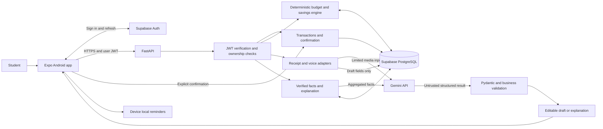

**CARENTA — implementation plan, architecture, and delivery agreement**

Prepared on 31 October 2026 for Group 07, CSC10014; revised after inspecting all 19 pages of the user-supplied `Figma.pdf`. This is a planning draft, not a record of implemented features or passed runtime tests. Target: an installable Android application for submission at the start of December 2026. Plan against **1 December** until the exact submission date is confirmed.

**The recommended stack is Expo / React Native / TypeScript, FastAPI / Python, Supabase Auth and PostgreSQL, and Gemini for receipt, voice, and insight generation.** Financial calculations remain deterministic. AI produces suggestions and editable drafts; only an explicit user action records a transaction.

**1. These decisions are confirmed by the project owner.** They supersede broader possibilities in the proposal drafts.

| Decision | Agreed constraint |
|---|---|
| Deliverable | A working mobile application; Android APK is required, iOS is optional. |
| Deadline | Start of December 2026; exact date remains to be supplied. |
| Capacity | Six members, approximately six hours each per week. |
| Experience | No existing mobile development experience; favor a small, conventional stack. |
| Product scope | Budgeting only. Food, pantry, recipes, and restaurant features are deferred. |
| Capture methods | Manual entry, receipt OCR, and voice must all work in the demonstration. |
| Available money | Actual funds already received, with unpaid commitments and savings reserved. Expected future income is separate. |
| Savings | One active virtual savings goal; no bank or wallet connection. |
| Goal-editor balance | “Số tiền thực tế” shows the calculated current balance, read-only. Correct financial records separately; editing a goal must not overwrite cash. Confirmed during the exported-design review. |
| Operating budget | Up to US$20–30 total for development and demonstration. |

Working defaults, which can be changed without redesigning the system: Vietnamese UI and spoken input, VND only, Asia/Ho_Chi_Minh timezone, calendar-month planning, one combined cash balance, and an online application. Account signup/recovery, offline synchronization, multiple wallets, and multiple currencies are outside the December scope.

**2. The source documents describe different stages of the project.** Their claims must not be combined into one oversized release.

| Source | What it establishes | How this plan uses it |
|---|---|---|
| `Group07.pdf`, pp. 1–9 | CARENTA budget concept; manual/OCR/voice capture; confirmation; charts/calendar; savings; proactive prompts. Page 9 identifies the stage as a Figma concept/prototype. | Product scope and proposal reference for December. |
| `Figma.pdf`, pp. 1–19 | Exported UI kit and navigation specification, then 17 screen/state pages covering capture, reports, savings, alerts, and calendars. | Primary visual reference. Every page was text-extracted, rendered, and visually inspected; page numbers below identify the evidence. |
| `Promptational Thinking.pdf`, pp. 5–6, 23–30, 31–66 | Earlier budget-and-food proposals, use cases, evaluation ideas, and a three-month development schedule. It also contains unrelated candidate projects. | Reuse the budgeting requirements, traceability approach, and deterministic budget-engine boundary. Do not inherit food scope or the three-month schedule. |
| Same document, pp. 67–72 | Detailed capture interactions, Figma responsibilities, navigation, visual guidance, and confirmation flow. | Supporting interaction and ownership reference. |
| `members.png` | Six current members and their role labels. | Source for the implementation ownership table below. |
| `Figma.txt` | Link to the live design file. | Optional source for future editable assets and component metadata; the PDF now provides the required visual evidence. |
| Local `AGENTS.md` and [repository contribution guidelines](../CONTRIBUTING.md) | Existing lab boundaries, broken package import, verification and contribution rules. | Keep the current backend separate and disclose actual verification. |

The PDFs, member image, Figma link file, and local `AGENTS.md` are reference files supplied in the working copy and are not included in this documentation contribution. Page references identify those local sources; the live design link below remains available subject to Figma access permissions.

The live design link is [CARENTA Figma file, root node 0:1](https://www.figma.com/design/ZMUPocwhpRYV8IyKs5vsyE/Untitled?node-id=0-1). File key: `ZMUPocwhpRYV8IyKs5vsyE`. Previous MCP reads were quota-blocked; **the exported PDF has now been reviewed and that no longer blocks visual planning**. This is an export-based review, not a successful live-node fetch. The PDF cannot establish node IDs, component/variable bindings, prototype wiring, animation timing, or unseen variants. Interaction decisions below are implementation specifications unless explicitly visible in a frame.

Export identity: 19 pages, 23,408,757 bytes, SHA-256 `33b8a0d4f3a37bf07c02d2b1574ee81fc4608a0d2cd68b304aac8df3a23207ee`. Page boxes are 390×1605 for the UI kit, 850×1446.5 for the navigation sheet, and 390×844 for pages 3–19, in PDF units. Rendering reported Type 3 font bounding-box warnings, so extracted text was cross-checked against all rendered pages. Exported device chrome is presentation material, not application content. Keep the PDF untracked under the repository's PDF rule.

If live access becomes available, use it to retrieve editable assets, exact tokens, and component metadata; do not delay the agreed release for that enrichment. Obtain a standalone pig illustration and icon/font assets from the design owner during implementation. Full-screen PDF renders must not become application screens or decorative stand-ins for interactive controls.

The requested `grill-me` wrapper refers to a separate `grilling` skill through a Skill tool, neither of which was available. The interview was conducted directly; the confirmed decisions above include the goal-editor clarification obtained during this review.

**3. The release should answer one concrete question: “Can I afford this purchase while keeping money for my bills and savings?”** Its advantage is persistent, user-confirmed financial records connected to daily decisions, with quick Vietnamese capture. This can be demonstrated without a general-purpose chatbot.

| Use case | December behavior | Acceptance evidence |
|---|---|---|
| UC01 — Initialize finances | Sign in; enter current balance, month-end planning horizon, unpaid commitments, and a savings goal. | Seeded example produces independently calculated balances. |
| UC02 — Record money manually | Add income/expense; select category/date; edit or delete a mistaken entry. | All affected totals update; saving twice does not duplicate an entry. |
| UC03 — Scan a receipt | Photograph or choose one receipt; extract total/category/date into an editable draft. | Real photo reaches review; confirm creates exactly one expense. |
| UC04 — Record by voice | Record one short Vietnamese purchase statement; display extracted fields and recognized text for review. | Real recording reaches the same confirmation screen as OCR. |
| UC05 — Review finances | View current cash, reserved amounts, daily allowance, month navigation, selected-day transactions, and week/month category reports. | Calendar cells, selected-day sheet, report totals, and category totals use the same ledger filters and reconcile. |
| UC06 — Manage savings | Create/edit one goal, select its deadline, allocate/release virtual savings, and open the full savings history. | Goal edits preserve cash and existing savings; date-picker cancellation preserves the prior date; allocations are not expenses. |
| UC07 — Receive guidance | See an overspending warning, a daily reminder, and a short explanation of verified spending patterns. | Messages use actual data and never silently create transactions. |
| UC08 — Evaluate a purchase | Preview an unsaved expense in the manual/review editor and see its effect on the relevant day's allowance and remaining discretionary funds. | The preview is explicitly labeled “after this purchase”; it writes nothing until the user chooses Save/Confirm. |

Keep OCR to one receipt total, and voice to one purchase per recording. Itemized splitting, transfer screenshots, real-time voice conversation, notification-reading from banking apps, Siri/Google Assistant integration, remote push infrastructure, and habit-prediction models are deferred. A bank-like visual style does not imply a banking integration.

**4. Implement the exported states as reusable flows, with explicit corrections where the mockups conflict.** All page references in this section refer to `Figma.pdf`. Nineteen exported pages do not require nineteen independent screens: the first two are design documentation, and several later pages are variants or overlays of the same view.

| Export pages | Observed screen or state | Implementation specification |
|---|---|---|
| 1 | UI kit: six named colors, four type sizes, buttons/chips, status badges, sample balance card. | Shared tokens, MoneyText, buttons, badges, and cards. The sample values are illustrations, not financial rules. |
| 2 | Two bottom tabs, “Thống kê” and “Tiết kiệm”; separate floating plus; two active-color states. | Exactly two primary tabs. The plus opens a modal action chooser and does not create a third destination. Respect Android system insets. |
| 3 | Full-screen dimmed capture chooser: OCR, voice, manual, and close control. | Modal overlay over the current tab, preserving its state. Accessible names, Android Back/close dismissal, and focus return to plus. |
| 4 | Reports: week/month/year controls, seven-day bars, category donut, category amounts, AI insight. | Reuse report data for both charts and the list. Ship week/month; omit the unimplemented Year control until supported. Add a visible route to Reports under the Stats tab. |
| 5 | Voice recording bar with waveform, trash, stop, and close. | Record only after permission. Stop ends microphone capture and submits; trash/close cancels and discards; enforce the 30-second cap. |
| 6 | Voice processing card with sample text; heading still says “AI đang lắng nghe”. | Distinct uploading/processing states; rename to “Đang xử lý giọng nói” once recording stops. Do not show fabricated live transcription or leave the microphone active. |
| 7 | Extracted transaction summary with Confirm and Quick Edit. | Shared OCR/voice review. Quick Edit opens the shared editor in draft mode and returns here without creating a transaction. Show missing-field and duplicate warnings. |
| 8 | Manual expense keypad, category, note, date, remaining-budget badge, Save. | Shared money editor; amount bounds, delete/000 key behavior, category picker, date selection, explicit saving state. Clarify the badge as the amount remaining after this unsaved purchase. |
| 9 | Dark receipt-camera screen, guide frame, gallery icon, shutter, back. | Camera/gallery → preview/retake → extraction → shared review. The decorative scan line is not evidence that OCR has succeeded. |
| 10 | In-app overspending, missing-entry, and habitual-purchase notices. | Overspending opens a budget-recovery preview; missing-entry action opens capture. Habit notices remain stretch scope, and their action opens review rather than silently approving unspecified money. |
| 11 | iOS lock-screen illustration containing two notifications. | Deliver opt-in Android local notifications through the operating system. Do not build the wallpaper, clock, weather widgets, or iOS notification cards inside the app. |
| 12 | Piggy-bank summary, goal progress, three daily money cards, recent savings history and “Xem tất cả”. | Savings root; tap pig or labeled Edit action to change goal; open full history. Add visible Allocate/Release controls because the export shows history but no way to make these actions. |
| 13 | Goal editor: saved amount, remaining target, two money fields, deadline, suggested daily saving, Save. | Current balance is read-only per user clarification. Target/deadline are editable; preserve allocated savings and cash. Replace judgmental helper copy with “Tính từ các giao dịch đã xác nhận”. |
| 14 | Goal-deadline bottom sheet, month arrows, selected date, Cancel/Confirm. | Keep a temporary date selection. Confirm updates the unsaved form; Cancel/Back restores its prior date. Only saving the goal submits the change. |
| 15 | Full history; title says “Lịch sử đập heo”, while rows are positive “Đút heo” contributions. | One paginated “Lịch sử tiết kiệm” view with allocation/release type and signed amount. Correct the conflicting title; retain repeated legitimate entries by record ID. |
| 16 | Dashboard, balance eye control, compact calendar, monthly summary. | Stats landing page. Eye toggles the displayed main balance with an appropriate accessibility label. Compact calendar and detailed calendar share the same data. |
| 17 | Detailed month calendar with per-day amounts, previous/next month, and monthly summary. | Reuse MonthCalendar with a detail layout. Select dates by full ISO date, handle overflow days, and exclude other months from the selected month's totals. |
| 18 | Selected-day bottom sheet over the detailed calendar; three transactions total 290,000 ₫. | Use this modal presentation for DayTransactionsSheet, with close/back, scrolling and safe-area padding. Reuse it from both calendar views. |
| 19 | The same selected-day sheet over the dashboard, with bottom navigation obscuring lower content. | Treat as another entry point to the same sheet. Fix the overlap: render the modal above the tab bar and plus; do not reproduce the clipping. |

The app navigation is a proposed wiring of these exported states, since a PDF contains no executable prototype links:

```text
Login → Financial setup → Two-tab shell
  Thống kê → Dashboard → Detailed month calendar → Selected-day sheet
                        → Reports (week/month)
  Tiết kiệm → Savings summary → Goal editor → Deadline picker
                             → Savings history
                             → Allocate / Release editor
  Plus from either tab → Capture chooser → Manual editor → Save
                                       → Receipt camera → Preview → Process → Review
                                       → Voice recorder → Process → Review
  Review → Quick Edit → Review → Confirm → Original tab + refreshed totals
```

Use a visible “Báo cáo” shortcut from Dashboard for page 4 and a “Xem lịch chi tiết” action for page 17. The top-right wallet icon on pages 4, 6, 12 and 16 is not assigned behavior in the export; use it to open the existing financial overview/settings route, including income and commitments. This does not introduce multiple wallets or a banking connection. Keep each tab's selected month and scroll position when opening/dismissing capture. Full-screen entry/camera forms and the goal editor can hide the tab bar as shown; an active modal blocks interaction with underlying tabs. Do not start a second capture while one recording/upload/review flow is active.

The design system's **declared** values are authoritative for initial tokens; the PDF does not expose live variable bindings:

| Token group | Exported value | Usage |
|---|---|---|
| Primary / success | Teal `#0F766E`; Emerald `#10B981` | Primary actions and Stats selection; success feedback. |
| Savings / warning / danger | Coral `#F43F5E`; Amber `#F59E0B`; Alert `#EF4444` | Savings selection; caution; overrun/error. |
| Main text | Dark `#0F172A` | Text token declared on page 1; validate secondary text and surfaces during implementation. |
| Typography | 24 bold / 18 semibold / 14 medium / 12 regular; page 2 specifies Inter for navigation | Reusable type roles with Android text scaling. Larger hero amounts visible in screens need a responsive amount style. |
| Navigation | 56×56 plus, 20-unit plus icon, rounded shape; reference bar height 84 including safe area | Preserve proportions and active states, while computing real device insets. Do not add 84 units and the same safe area twice. |

Keep the teal/coral palette, rounded cards, pig illustration, and restrained shadows. Exact radius/shadow/spacing values beyond the annotated sheet remain implementation choices, not recovered Figma tokens. Set touch targets to a minimum design target of 48 dp and test a narrow Android screen and enlarged text. Reuse one calendar, one money editor, one transaction review, one selected-day sheet, and one savings-history list. Ensure scroll content clears fixed actions/navigation; modal headings and errors must be reachable by accessibility services.

The following corrections are part of the implementation, rather than new product scope:

| Finding | Required behavior / copy correction |
|---|---|
| Currency formatting varies between `₫35,000`, `45.000 đ`, `VNĐ`, and amounts with both a symbol and VND. | Standardize visible amounts to `35.000 ₫`, with readable compact amounts only where needed. The symbol in page 7 is the dong sign; the earlier draft's dollar-sign interpretation was incorrect. |
| Home “Tổng số dư khả dụng” and savings “Tổng tiền dư / Có thể chi” do not distinguish cash from reserved funds. | Label the home cash card “Tổng số dư ghi nhận”; label discretionary funds “Có thể chi đến cuối tháng”. Show the reserve breakdown through the financial overview. |
| Page 8's 75,000 ₫ badge is unclear about whether its 45,000 ₫ draft is included. | Label “Còn 75.000 ₫ sau khoản chi này” when prior remaining allowance is 120,000 ₫. Recalculate for the selected transaction date; no write occurs while typing. |
| Page 13 attributes straightforward goal arithmetic to AI. | Label deterministic output “Mức tiết kiệm đề xuất”. AI may explain the plan separately; the numeric suggestion must work without a provider call. |
| Page 17's July 1–31 daily amounts sum to 7,640,000 ₫, but the monthly summary says 4,850,000 ₫. | Replace inconsistent sample data with one coherent ledger fixture. Derive the selected month total from the same daily aggregation used by the cells. |
| “Ngân sách tháng — 12 / 15 ngày” is not a defined currency budget or adherence measure. | Label “Ngày trong hạn mức: 12/15 ngày đã đánh giá” only if those counts are supported by saved daily plans and confirmed records. Exclude future days and days with no plan/data; show the unevaluated count separately. |
| Teal selected-day fill and teal normal-status legend can be confused; page 16 has blank amounts despite a nonzero summary. | Separate selection styling from adherence indicators; add accessible status text. Blank/unknown is not zero, not an empty-account state, and not evidence of being within budget. |
| Page 10 offers “Duyệt 1 chạm” without showing amount/category/date. | Use “Xem và xác nhận” to open a draft if that stretch feature is built. Revalidate data after opening a notification; only the reviewed Confirm action writes. |
| Pages 12–15 have contribution history but no visible allocation/release entry point. | Add explicit savings actions using the money editor in allocation mode; keep the central plus dedicated to capture. |

Screens/states not supplied by the export still need small designs in the same visual system: demo login, financial setup and overview, income entry, commitments, allocation/release confirmation, goal-not-created/completed/overdue, transaction edit/delete, capture preview/retake, permissions, loading/error/empty/offline states, budget-recovery preview, and settings/data deletion. Assign these as states of the existing flows, not separate feature expansions. Native Android status/navigation bars replace the drawn iOS chrome.

**5. Use a small stack that the team can learn and debug within four weeks.** Pin compatible dependency versions and commit lockfiles after the first physical-device trial.

| Layer | Selection | Reason and boundary |
|---|---|---|
| Mobile | React Native with Expo, TypeScript, Expo Router | One mobile codebase, Android-first delivery, navigation and native capabilities without maintaining separate native apps. |
| UI | React Native components and StyleSheet; reusable design tokens; `react-native-svg` for simple charts | Translate the exported UI kit into shared tokens. Reuse calendar, editor, review, and sheet components across the exported variants. |
| Client data | TanStack Query plus component state | Fetch/cache server data; invalidate affected queries after mutations. Keep balances authoritative on the server. |
| Native input | `expo-camera`, `expo-image-picker`, `expo-audio` | Receipt photos/gallery and short microphone recordings. |
| Device services | `expo-secure-store`, `expo-notifications` | Protect session credentials; schedule local reminders with explicit permission. |
| API | Python 3.12, FastAPI, Pydantic, Uvicorn | Typed request/response contracts, Python financial functions, and small provider adapters. |
| Identity and database | Supabase Auth and PostgreSQL | Managed identity; relational financial records; migrations and ownership policies. |
| AI | Google GenAI Python SDK; initial candidate `gemini-3.5-flash-lite` | One multimodal provider for image/audio extraction and short explanations. Validate Vietnamese quality before freezing this choice. |
| Deployment | One FastAPI service on Render; Supabase managed database | Small deployment surface. Raw media must not depend on persistent server disk. |
| Verification | pytest, HTTP API integration tests, React Native Testing Library/Jest, physical Android checklist | Focus tests on money, confirmation, authorization, and failures. |
| Delivery | Local Android build or available EAS build allowance; standalone preview/release APK | Demo installation must launch with bundled JavaScript without a developer's Metro server. |

Expo documents native [camera](https://docs.expo.dev/versions/latest/sdk/camera/) and [audio recording](https://docs.expo.dev/versions/latest/sdk/audio/) support. Its [notification documentation](https://docs.expo.dev/versions/latest/sdk/notifications/) distinguishes local notifications from remote push and notes Android remote-push restrictions in Expo Go. Use an actual installed development build early, followed by the standalone APK delivery gate.

The selected [Gemini model](https://ai.google.dev/gemini-api/docs/models/gemini-3.5-flash-lite) supports image/audio input and structured output. Those capabilities establish suitability for a trial, not measured receipt or Vietnamese speech accuracy. Keep the model ID configurable. Use a shallow schema supported by the selected API and validate all results in Python; [structured output does not guarantee semantic correctness](https://ai.google.dev/gemini-api/docs/generate-content/structured-output?hl=en).

The architecture needs one API process and one relational database. Separate microservices, vector search, RAG, agent orchestration, message brokers, and model training do not contribute to the approved December acceptance criteria.

**6. Keep capture, financial rules, and persistence separate inside one backend.** This lets the three capture methods converge on the same reviewed transaction contract.



The app signs in with Supabase, then sends its access token to FastAPI. The API verifies signature, issuer, audience, and expiry using the supported Supabase signing-key flow. Each database request carries that user's JWT through a request-local client, so row-level policies apply. Never mutate one shared client's authentication state across concurrent requests. Derive ownership from verified identity rather than accepting `user_id` from a request body.

Use RLS on every user-owned table, including drafts and usage records. Financial write operations that update multiple records use database transactions/RPC functions. Enforce ownership and value constraints inside those functions as well. A server secret/service-role key can bypass RLS; it must not be the default data path or be shipped to the app. See [Supabase JWT guidance](https://supabase.com/docs/guides/auth/jwts) and [RLS documentation](https://supabase.com/docs/guides/database/postgres/row-level-security).

The financial engine consumes validated records and produces a budget snapshot. The AI adapter has no database credentials, arbitrary SQL tool, transaction-confirmation tool, or ability to change a goal. Cached insights are keyed by the underlying data revision so a deleted or edited transaction invalidates an old explanation.

**7. Define the money semantics before implementing the dashboard.** Transaction input amounts are positive integer VND values; direction is a separate enum, and derived balances can be zero or negative. Do not use floating-point money. Persist instants in UTC and use Asia/Ho_Chi_Minh for user-facing days and month boundaries. Date-only receipt evidence remains a date; do not invent a precise purchase time.

For a confirmed plan covering the remainder of the current calendar month:

```text
cash = opening balance + confirmed income - confirmed expenses

protected = unpaid commitments
          + savings already allocated
          + savings still reserved for this planning period

discretionary_raw = cash - protected
safe_to_spend = max(0, discretionary_raw)
funding_shortfall = max(0, -discretionary_raw)

daily_allowance_at_plan_creation = floor(safe_to_spend / days_remaining_inclusive)
```

Future expected income never enters `cash` until the user records receipt. Opening balance includes all money already held, including existing virtual savings; store its effective date/time and explain that income/expenses already included in that balance must not be added again. For the MVP, reject historical entries before the opening-balance boundary unless the user first reconciles that baseline. Display the shortfall explicitly rather than hiding it behind a zero allowance. An actual expense may reveal a negative recorded balance; preserve the record and ask the user to reconcile missing income or incorrect entries instead of refusing to record what happened.

For a goal, compute `remaining_target = max(0, target - allocated_savings)`. To match page 13's example, `saving_days = deadline_local_date - today_local_date`: the projected saving days are tomorrow through the deadline, distinct from the daily spending plan's inclusive day count. For positive saving days, suggest `ceil(remaining_target / saving_days)` integer VND per day. With a frozen date of 12 July 2026, a deadline of 11 August 2026, a target of 2,000,000 ₫ and 1,250,000 ₫ already saved, this gives 30 days and 25,000 ₫/day. Cap the final contribution at the remaining target. The UI's “750,000 ₫ / tháng (30 ngày)” is a 30-day projection, not a claim that all calendar months have 30 days.

At plan creation, propose the portion needed for the current period, show feasibility against actual funds, and ask the user to accept it. Persist this period reservation. Do not silently recalculate it downward every day or automatically relax the user's goal when spending increases. Treat a completed goal as completed, an unmet goal due today as due-today, and a past-due goal as overdue; never divide by zero or a negative day count. Reaching month-end requires a new period plan with current funds and commitments.

The goal editor receives current cash from the server as read-only context. A separate financial-records screen supports adding omitted income or correcting erroneous transactions. The goal write contract must reject attempts to set cash, opening balance, or already-allocated savings. A date-picker Confirm only updates the local draft; the final “Lưu mục tiêu” validates the data revision and atomically accepts the goal and its revised period reservation. Cancelling the form writes nothing.

Allocating money to the piggy bank moves value from the period's still-reserved savings into allocated savings. It does not change cash or create an expense. Allocating above the remaining planned reservation reduces discretionary funds by the excess. Releasing savings requires an explicit action and recalculation of the still-required period reservation; display the preview before confirmation. Goal edits similarly require a new confirmed plan.

When a user pays a reserved bill, insert the linked expense and reduce the unpaid commitment by the same paid amount atomically. Partial payment reduces only the unpaid remainder. Deleting or correcting that linked transaction restores/reconciles the commitment in the same operation. Otherwise the bill would be deducted twice.

Example: cash is 3,000,000 ₫; unpaid rent is 1,000,000 ₫; allocated savings are 200,000 ₫; additional savings reserved this month are 300,000 ₫. Discretionary funds are 1,500,000 ₫. With 15 days remaining, the daily allowance is 100,000 ₫. Paying the reserved rent changes cash to 2,000,000 ₫ and unpaid rent to zero, leaving discretionary funds at 1,500,000 ₫. Allocating 100,000 ₫ into savings changes allocated/reserved savings to 300,000/200,000 ₫, again leaving discretionary funds unchanged.

Save the allowance when a daily plan is created. Compare today's discretionary spending with that allowance, rather than moving the comparison threshold after every purchase. Show remaining allowance and any overrun separately. Recompute future guidance from remaining funds; never promise that an impossible goal can still be achieved. New income, a changed commitment, or a changed goal can create an explicit new plan version. Historic calendar status uses the historic plan version; backdated edits trigger recalculation of affected summaries and flag any affected plan comparison. Adherence counts include only past/current dates with both an applicable plan and confirmed activity; days with no records remain unevaluated unless a future explicit “no spending” feature is added. The calendar must not treat missing logging as evidence of successful budgeting.

UC08 is a preview in the existing expense editor: subtract a proposed unreserved purchase from available discretionary funds and the selected day's remaining allowance, show both effects and the shortfall, and write nothing. When editing an existing expense, exclude its original value before applying the replacement so the preview does not count both. When a historic date has no saved plan, show its transaction totals and “Chưa có hạn mức cho ngày này” rather than today's allowance. Ordinary income, reserved bill payments, and savings allocations are not discretionary purchases. Saving revalidates the current server revision; an old green preview is not permission to bypass new budget information.

**8. Use a compact relational model with explicit relationships.** Balances and analytics are derived; the app does not maintain independently editable copies of totals.

| Table | Essential fields and rules |
|---|---|
| `profiles` | Auth user ID, opening balance VND and effective boundary, timezone, currency, display preferences, reminder preference; no student ID required. |
| `transactions` | ID, owner, income/expense kind, amount VND, category, transaction date/time precision, note, source, optional draft/commitment ID, idempotency key, version, created/updated/deleted timestamps. |
| `commitments` | ID, owner, title, planned amount, due date; unpaid amount derived from linked payments. |
| `goals` | ID, owner, target, deadline, active state; at most one active goal per owner. |
| `goal_allocations` | ID, owner, goal ID, allocation/release kind, amount, timestamp, idempotency key; these are allocations, not income/expenses. |
| `budget_plans` | Owner, period boundaries, confirmed savings reservation, goal reference, revision, confirmation time. |
| `daily_plans` | Owner/date/plan revision, allowance, calculation inputs or reproducible snapshot; preserve history. |
| `capture_drafts` | ID, owner, receipt/voice source, extracted fields, uncertain fields, model/prompt version, pending/confirmed/cancelled/expired state, expiry, confirmed transaction ID. |
| `ai_usage` | Owner/request ID, task, model, token/cost estimate, latency, status, timestamps; exclude raw media and financial text. |

Use fixed category codes for the first release. Add foreign-key ownership checks, database amount bounds, unique `(owner, idempotency_key)` constraints, and a unique transaction reference per confirmed draft. Scope uniqueness to the owner so users do not collide. Use optimistic version checks for edits. Ordinary transaction deletion is a soft deletion: exclude it from totals and reconcile linked bills, while retaining the idempotency record so an old retry cannot recreate it. Explicit account-data deletion removes the user's retained application records. No successful response is returned until the database commit succeeds.

Database migrations and sample records must be reproducible. Keep real receipts, audio, personal balances, tokens, and credentials out of the repository. Use synthetic records for the demo and consented, redacted samples for evaluation.

**9. Freeze the API contracts in the first week.** All money responses use integer VND and explicit field names. Errors contain a stable code, a user-safe message, and a request ID.

| Endpoint | Contract |
|---|---|
| `GET /health` | Deployment health, without secrets. |
| `GET /v1/dashboard` | Cash, reserve breakdown, discretionary funds, shortfall, today's allowance/spending, goal progress, last data-update time, and data revision. All financial cards use named fields rather than a generic “balance”. |
| `GET/POST /v1/transactions` | Paginated/date-filtered reads and explicit manual creation. POST requires an idempotency key. |
| `PATCH/DELETE /v1/transactions/{id}` | Owner-scoped correction/removal with version check and linked commitment reconciliation. |
| `GET/POST /v1/commitments`; `PATCH/DELETE /v1/commitments/{id}` | Manual commitments; validate ownership and unpaid amounts. Reconcile linked payments; prevent orphaned bill records. |
| `GET/POST/PATCH /v1/goal` | The user's single active goal. Obtain a revised reservation preview before the final write; creation/update accepts its current revision and atomically saves the goal and reservation. Reject client-supplied cash or saved-balance overrides. |
| `GET /v1/goal/allocations` | Paginated allocation/release history for page 15, with stable IDs, signed presentation amount, timestamp, and type. The recent-history preview is the first page of the same data. |
| `POST /v1/goal/allocations` | Explicit allocation/release with an idempotency key and atomic reserve validation. |
| `POST /v1/budget-plans/preview` | Show consequences of proposed commitments/goal settings or an overspending-recovery request without writing them. Include versioned acceptance data for the final goal/plan save. |
| `POST /v1/budget-plans/confirm` | Accept a preview against the current data revision; reject stale previews. |
| `POST /v1/captures/receipt` | One validated image; return an editable draft, never a recorded transaction. |
| `POST /v1/captures/voice` | One short recording; return recognized text and the same draft contract. |
| `PATCH /v1/drafts/{id}` | Save user corrections to a pending draft. |
| `POST /v1/drafts/{id}/confirm` | Atomically validate, insert the transaction, and mark the draft confirmed; retries return the same transaction. |
| `DELETE /v1/drafts/{id}` | Cancel a pending draft; no change to cash. |
| `GET /v1/reports` | Bounded week/month range with full local dates, daily/category totals, evaluated/within-limit/overrun/unevaluated day counts, applicable plan revisions, and data revision. Overflow dates in a calendar grid do not enter the selected month's totals. |
| `POST /v1/insights` | Explain a supplied/current server data revision; cache results and enforce usage limits. |
| `POST /v1/purchase-preview` | Amount, selected date, optional edited transaction ID, and data revision in; deterministic after-purchase allowance/discretionary breakdown out; no ledger mutation. |
| `DELETE /v1/user-data` | Explicitly delete this user's application data; keep the demo identity only if the UI clearly says so. |

API documentation should come from the Pydantic/OpenAPI contracts. Generate or maintain matching TypeScript types from these contracts. Do not copy the existing synchronous office-lookup `reply()` signature into the financial API.

**10. Make every AI interaction bounded, inspectable, and recoverable.** Both AI capture paths must finish at the same review component and transaction service.

```text
capture → upload → extract → validate → review/edit → explicit confirm → save
                                      ↘ cancel / correct manually
```

For receipts, accept a single JPEG/PNG image, target a small compressed upload, and enforce a server limit such as 5 MB. Check actual file type and decoded dimensions, strip unnecessary metadata where practical, and reject corrupt or oversized input. Extract the payable total rather than cash tendered, change, subtotal, or each item price. Keep dates and categories uncertain when evidence is missing. A repeat image or matching amount/date can produce a duplicate warning, but a legitimate repeated purchase must remain confirmable.

For voice, cap recordings at 30 seconds, verify the actual format produced by the Android device, and support one purchase statement. Test examples such as “Cơm trưa ba mươi lăm nghìn”, “trà sữa 35k”, “hôm qua đi xe hết 20 nghìn”, and “một triệu hai”. Missing amounts, ambiguous units, multiple purchases, negation, and corrections must produce a review prompt or manual-edit fallback. Never silently turn “I did not buy coffee” into an expense.

Model the mobile capture state explicitly as `idle → requesting_permission → recording/camera_preview → uploading → processing → review → saving → success`, with cancel/error transitions. Page 5 is the only microphone-recording state. On Stop, Cancel, Back, or leaving the recording view, stop and release microphone capture before transitioning. Page 6 is processing feedback; show actual transcript content only after it is returned. The PDF's waveform does not require streaming transcription, and the earlier notes' animation delay does not replace completion of a real request. Quick Edit preserves `draft_id`; returning to review never saves a second copy.

The extracted schema should include amount, currency, category code, transaction date/time precision, short description, uncertain fields, and relevant evidence. Unknown values are `null` or explicitly unresolved. Do not present a model-generated confidence number as a calibrated probability. Missing required fields disable confirmation until the user supplies them.

Use a bounded provider timeout, initially 20 seconds, and at most one retry for transient failures. The client retains the draft/editor state and offers retry or manual entry. After a timeout following confirmation, look up the idempotency key before retrying a write. A provider failure never means an expense was recorded. Replayed demonstration fixtures must be labeled as fixtures and do not count as live OCR/voice acceptance evidence.

Receive media temporarily for processing and remove server/device temporary copies after success, cancellation, or failure. Do not store raw receipts or audio by default. Avoid provider file-upload storage when a bounded inline request is sufficient; if used, track and delete uploaded provider files explicitly. The application's deletion behavior does not imply that it overrides the provider's retention policy. Explain external processing before the first upload.

For insights, Python calculates totals, comparable date windows, category differences, and possible daily savings. Pass only those facts and the goal context to the model. Require returned fact references; substitute verified numbers into the final displayed text. If the previous period is zero or incomplete, avoid misleading percentage-growth claims. If an explanation fails validation, display a deterministic sentence from the same facts.

Local reminders are generic and opt-in, with a user-selected time. Page 11 is an illustration of system delivery: the operating system can display a scheduled local reminder while the app is closed, without a server push service. Use generic copy such as “Kiểm tra và ghi lại chi tiêu hôm nay” because the scheduled message may not know about later changes. The exact missing-entry message on page 10 is appropriate only after checking current records in the app. Cancel/reconcile same-day reminders after a successful entry where supported, and re-check records when the user opens the app. Notification actions open the relevant flow after authentication; they never create financial records in the background.

Overspending warnings are generated after confirmed financial changes. “Xem kế hoạch điều chỉnh” opens the existing plan-preview flow and does not silently change the savings goal. If habitual suggestions are implemented after core acceptance, “Xem và xác nhận” opens a reviewable draft with editable fields, and “Bỏ qua” dismisses it without writing. Keep the notification deep-link target on an allowlist and handle expired drafts by opening the normal editor. Remote push infrastructure remains outside the December scope.

**11. Assign one accountable owner per workstream and a different reviewer.** These are proposed implementation assignments consistent with the image's roles; they do not claim that the members have already accepted or completed them.

| Member | Roles from the supplied image | Primary implementation ownership | Reviewer / partner |
|---|---|---|---|
| Nguyễn Phúc Khánh | Leader; AI-Integration | API contracts, authentication/deployment integration, voice adapter and recording/processing state boundary (pp. 5–7), release coordination. | Trần Thành Lợi reviews AI; Trần Phúc Khánh reviews identity/data access. |
| Trần Phúc Khánh | QA/QC; Developer; Security & Data | Schema/migrations/RLS, ledger, budget rules, commitments, savings accounting and critical tests. | Nguyễn Phúc Khánh; Nguyễn Minh Khang validates expected calculations. |
| Lý Tuấn Kiệt | Presenter; Developer | Mobile API integration, manual entry (p. 8), reports (p. 4), shared dashboard/calendar/day sheet (pp. 16–19), and financial overview. | Đặng Xuân Phát reviews UI; Nguyễn Minh Khang checks flows. |
| Trần Thành Lợi | AI-Integration; Developer | Receipt extraction, structured-output validation, insight generation and provider-cost instrumentation. | Nguyễn Phúc Khánh; Nguyễn Minh Khang evaluates held-out cases. |
| Đặng Xuân Phát | UI/UX; QA/QC | Exported tokens/navigation (pp. 1–3), shared review/editor styling, savings/editor/date/history flows (pp. 12–15), missing-state designs, assets and accessibility. | Lý Tuấn Kiệt for integration; Nguyễn Minh Khang for acceptance. |
| Nguyễn Minh Khang | AI-Integration; QA/QC; Presenter | Evaluation fixtures/harness, export-to-behavior checklist, end-to-end tests, local alerts/reminder actions (pp. 10–11), demo script and evidence. | Trần Phúc Khánh for data tests; Đặng Xuân Phát for usability. |

Each person has approximately 24 hours across four weeks, including learning, meetings, review, testing, and presentation work. These are not six full-time engineering positions. Pair on unfamiliar mobile setup in week one and use shared API fixtures so UI work can proceed before every backend route is finished. Avoid six independently implemented screens with incompatible data contracts.

**12. Plan for 144 team-hours, with the final 36 hours protected for verification and delivery.** The baseline is tight. The export review does not increase capacity: fit its variants into shared components, include missing/error states in each owner's work, and defer Year reports, habit suggestions, and optional iOS work. Visual implementation can proceed from `Figma.pdf` without waiting for live MCP quota.

| Work package | Team-hours, estimate |
|---|---:|
| Tooling, initial APK, contracts, deployment, CI setup | 12 |
| Ledger, identity/data access, budget, commitments, savings | 26 |
| Shared mobile components and essential screens | 26 |
| Receipt and voice integration, including early trials | 20 |
| Fact-based insight and basic alerts/reminders | 8 |
| Planning, coordination, code review, integration during development | 16 |
| Dedicated regression, evaluation, bug fixes, documentation, demo | 36 |
| **Total** | **144** |

| Dates | Capacity | Required result / exit gate |
|---|---:|---|
| 2–8 November | 36 h | Resolve the legacy import blocker in a separate issue/PR; freeze core contracts and money examples; implement the exported tokens/two-tab shell; map required missing states and obtain standalone assets; install an Android development build; authenticate; save one manual transaction; run live image and Vietnamese audio trials. |
| 9–15 November | 36 h | Ledger, commitments, savings actions/history, and basic dashboard integrated. Manual, receipt, and voice reach the shared review/editor and persist a confirmed transaction. Recording stops before processing. Double-confirm, read-only goal balance, and cross-user tests pass. |
| 16–22 November | 36 h | Shared month calendar/day sheet and category reports, goal/date editing, editor affordability preview, insights, reminders and failure states complete. Reconcile summaries to fixtures and remove modal/tab-bar overlaps. Produce a standalone APK and freeze features on 22 November. |
| 23–29 November | 36 h | Run held-out evaluation and physical-device checks; fix failures; complete a small usability trial; finish report and AI disclosure; rehearse the demo; install the release candidate on a second phone. |
| 30 November–submission | Buffer | Use only for packaging or urgent regression fixes; do not assume extra person-hours are available. |

Critical dependency chain: confirmed data semantics → contracts/schema → manual transaction → shared confirmation → OCR/voice integration → dashboard reconciliation → release evidence. The first-week AI trials run alongside foundation work, because postponing them until the final week would leave the largest unknowns unresolved.

If a gate slips, reduce polish, yearly reports, habit suggestions, and optional iOS work first. Keep all three capture methods, explicit confirmation, money correctness, account isolation, and a working APK. If those core requirements remain infeasible after the second-week gate, report the gap and renegotiate scope; do not silently substitute mocked AI for a required working capability.

**13. Turn requirements into measurable evidence.** These are proposed acceptance targets, not results obtained during planning.

| Area | Proposed acceptance gate |
|---|---|
| Deterministic finance | Every agreed golden case passes exactly, including integer rounding, month-end, goal deadline, zero income, shortfall, backdating, refunds, allocation/release, and partial/edited bill payments. |
| Write integrity | Repeated confirmation, retry after response loss, concurrent edits, cancelled drafts, and stale plan acceptance never create unintended duplicate or inconsistent records. |
| Exported navigation and modal states | Both primary tabs open the same plus chooser; Back/cancel restores the originating view; Quick Edit returns to review without saving; the day sheet covers underlying tabs and all rows remain reachable. |
| Goal editing | The balance field is read-only; attempted API cash overrides are rejected. Picking then cancelling a date changes nothing; accepting a date changes only the local form until Save. Saving target/deadline preserves current cash and allocated savings. |
| Export arithmetic and data consistency | Frozen 12 July → 11 August 2026 goal case yields 30 days and 25,000 ₫/day. The selected-day fixture is 65,000 + 45,000 + 180,000 = 290,000 ₫. July-only cells, summary, report and categories reconcile; adjacent August dates are excluded. |
| Preview and calendar meaning | A 45,000 ₫ unsaved expense against 120,000 ₫ remaining shows 75,000 ₫ after-purchase without a write. Missing-plan/no-record days are unevaluated; selected styling does not imply within-budget status. |
| Authorization | User A cannot read/change/confirm User B's records through any route or database/RPC path, including guessed IDs. |
| Receipt extraction | On at least 20 held-out readable receipt samples, payable amount exact match ≥90%; report category/date separately. Include cash tendered/change traps. |
| Voice extraction | On at least 20 held-out single-purchase Vietnamese recordings, amount exact match ≥90%; report performance for noisy speech and ambiguous units separately. |
| Ambiguous/adversarial input | At least 20 cases covering unreadable images, silence, missing amounts, multiple purchases, negation, prompt injection, and corrupt uploads. No case bypasses review or produces an autonomous write. |
| Latency | Warm dashboard/manual save p95 <2 seconds; capture-to-review p95 <15 seconds on documented demo Wi-Fi. Report cold starts/timeouts separately. |
| UX | Five volunteer students try the three capture paths and find their remaining budget. Target at least four completing each task without help; record errors and time rather than claiming population-wide benefit. |
| Installation | Standalone APK installs and launches on two physical Android devices without Metro; permissions, cancellation, denied access, and background/resume are exercised. |
| Native input and alerts | Stop/Cancel/Back releases the microphone; a timed-out processing screen does not show an active listening state. Tapping a local notification opens an authenticated flow without changing the ledger. |
| Visual usability | At a 390-wide reference layout, a narrow Android viewport, and enlarged text: readable money/labels, no clipped actions/history, reachable modal controls, correct active tab, and no fake iOS system chrome. |

Separate development fixtures from held-out evaluation data. Record model ID, prompt version, date, device, network, sample count, exact outputs, correction rate, failure reasons, and estimated cost. Have a teammate check the labels independently. A single successful demo example is not an accuracy measurement. The PDF's inconsistent monthly total is a design-data defect, not a golden expected value. The 7,640,000 ₫ sum is useful for a calendar reconciliation fixture only if the complete displayed July dataset is deliberately used.

Use CI for Python financial/API tests and TypeScript checks plus focused component tests. Mock the provider in ordinary CI; run a small, explicitly budgeted live smoke test before release. Add a reproducible finance regression dataset separate from the existing `eval/cases.csv`, whose 15 office-lookup cases must retain their current contract.

The earlier document proposes a longer before/after field study and savings-impact targets. A short December usability trial cannot establish spending reduction, habit improvement, or causal benefit. Report those as future research questions.

**14. Keep spending and operational failure modes visible.** The following amounts are team budget allocations, not quotes for guaranteed service packages.

| Item | Allocation |
|---|---:|
| Supabase | US$0 target, using the Free tier for the small pilot. |
| AI API | Up to US$10; use request limits, bounded media/output sizes, cached insights, and usage recording. |
| API hosting | Reserve up to US$10; develop on a free service and verify the actual paid option before any upgrade. |
| Contingency | Up to US$10, within the total approved US$30 cap. |
| Android distribution | Local builds or available free build allowance; no store publication required. |

The [Supabase Free plan](https://supabase.com/pricing) currently includes a 500 MB database and pauses inactive projects after a week. [Render Free services](https://render.com/docs/free) spin down after 15 idle minutes and can take approximately a minute to wake. Check both environments before rehearsals and disclose cold-start behavior in performance results. If an always-on host cannot fit the budget, retain a tested local API demonstration fallback and label it clearly.

Use the paid standard Gemini service for any consented personal samples, after checking its terms. The [pricing page](https://ai.google.dev/gemini-api/docs/pricing) distinguishes free-tier content use for product improvement from standard paid-tier treatment. Development should primarily use synthetic/redacted data. Do not enable a contributor/data-sharing option accidentally. Provider billing alerts are not necessarily hard spending stops: enforce per-user and global application request/cost thresholds, with room for in-flight calls, and check actual billed usage.

Keep provider keys only in backend environment variables. Redact request bodies, transcripts, media, and tokens from logs. Grant camera/microphone/notification permissions only when the corresponding feature is used. Keep read caches scoped to the signed-in user and clear them on logout. For December, avoid durable offline financial writes; show a clear connection error and preserve the current in-memory editor until retry or cancellation.

**15. Integrate into this repository without misrepresenting the starter.** The checkout currently implements a synchronous campus-office lookup under `src/assistant-core/`; it is not a mobile budget backend. The documented import name is `assistant`, which is absent. The existing baseline is therefore blocked; this planning work does not claim it passes.

Resolve the package mismatch as its own issue and reviewed change before relying on the original regression suite. Build CARENTA alongside it, with proposed locations such as:

```text
apps/mobile/                     Expo application and native configuration
services/carenta-api/
  app/main.py                    FastAPI composition and routes
  app/auth.py                    JWT validation and request identity
  app/transactions.py            Shared transaction/confirmation service
  app/budget.py                  Pure financial calculations
  app/savings.py                 Goal and allocation rules
  app/capture.py                 Receipt and voice workflows
  app/insights.py                Verified facts and explanation validation
  app/schemas.py                 Pydantic contracts
  app/repository.py              User-scoped database access
  app/providers/gemini.py        Bounded provider adapter
  tests/                         Finance, API, ownership, and failure tests
supabase/migrations/             Schema, constraints, RLS, atomic functions
eval/carenta/                    Synthetic cases, labels, evaluation reports
docs/carenta-implementation-plan.md
```

These paths are proposals; creating this document does not create the application or these directories. Keep `lab02/`, the intentionally flawed `lab03/monolith/`, the office data, and the existing 15-case evaluation separate. Reassess module splitting as code grows; the diagram does not require every box to become a separate package.

Use issue → branch from updated `main` → linked PR → teammate approval before merge. Create a planning issue and feature issues from UC01–UC08 and the delivery gates; use real issue numbers only once created. Complete the PR template with an actual `Closes #N`, actual checks, and AI disclosure. Human review and CI completion must be recorded only after they happen. PDFs remain local and untracked; never stage them or add PDF ignore patterns. Stage explicit paths.

This planning contribution is tracked in [issue #30](https://github.com/khanhf-ng820/assistant-team07/issues/30) and prepared on `docs/30-carenta-implementation-plan`, branched from the fetched `origin/main`. It publishes the plan, documentation index entry, and AI-use disclosure. Application implementation, teammate approval, and merge remain separate steps; no passing runtime baseline or CI result is claimed.

**16. Finish with a demonstration that proves the core behavior.** Use a resettable synthetic account with independently checked expected totals.

1. Launch the installed APK and sign in.
2. Show received funds, an unpaid bill, and the savings reserve breakdown.
3. Add a manual purchase and inspect the resulting daily/category totals.
4. Scan a real test receipt, use Quick Edit to correct one field, return to review, confirm, and show exactly one new entry in the selected-day sheet.
5. Record a Vietnamese purchase statement, stop recording, show the distinct processing state, inspect the draft, and confirm it.
6. Pay the reserved bill and show that discretionary funds are not reduced twice.
7. Allocate money to the piggy bank and show unchanged total cash and expense totals. Open savings history, edit the target/deadline, and show that the calculated balance and prior savings remain unchanged.
8. Preview a purchase that would exceed the allowance; show the deterministic explanation and an AI insight based on verified facts.
9. Demonstrate one failure path: deny microphone permission or interrupt upload, then recover without creating an expense.

Submission artifacts: installable APK, source revision, setup instructions, architecture/data-flow diagram, use-case-to-test matrix, exact evaluation results and limitations, demo script/video fallback, and AI-use disclosure. Follow the lecturer's current submission instructions for file names and slide format; the Week 01 requirements in the PDF are not proof of the final submission rubric.

Outstanding delivery items are the exact December date, availability of two Android phones, standalone illustration/icon/font assets, small missing-state designs, and first-week extraction measurements. The exported screen review and the meaning of “Số tiền thực tế” are resolved. Live Figma metadata would enrich the handoff but is not a prerequisite for implementing this plan. None of these items is a reason to expand the agreed product scope.

Planning verification: `Group07.pdf` and `Promptational Thinking.pdf` were text-extracted; key proposal UI pages and the member image were visually inspected. All 19 pages of `Figma.pdf` were text-extracted, rendered, and visually inspected; the confirmed balance-field decision was incorporated. The July calendar sum, selected-day total, goal progress/day calculation, financial examples, and 144-hour allocation were checked independently. Current official technology documentation was consulted during the original planning pass. Document links, Markdown fences, all 19 source page mappings, the export hash, and diff whitespace passed checks for this revision. Before publication, `.venv/bin/python -m pytest -q` was attempted and exited with two collection errors in `tests/test_eval.py` and `tests/test_smoke.py`: `ModuleNotFoundError: No module named 'assistant'`. This is the documented existing package import blocker, not a passing baseline. No application code changed or live AI-provider calls were made. Human inspection remains required.
