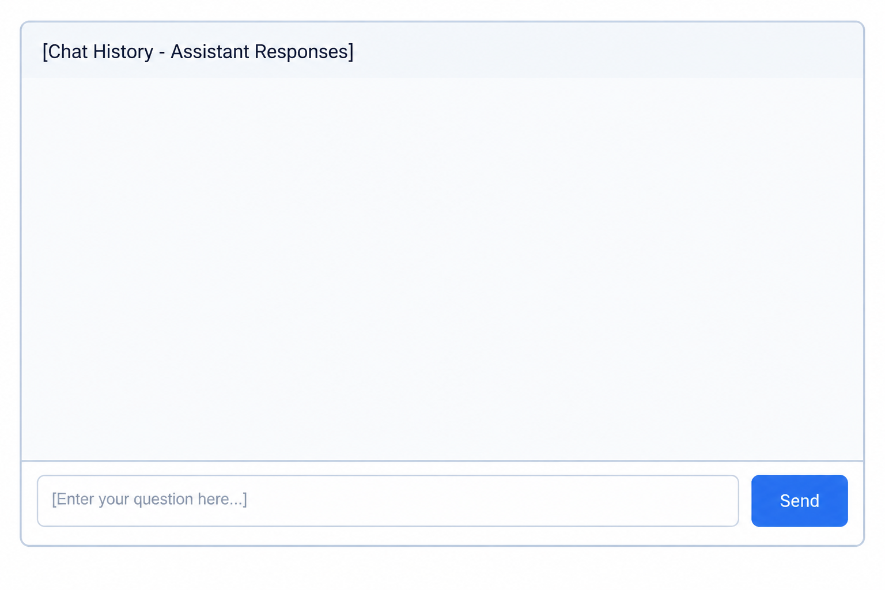

# User Interface (UI) Development Plan

This document outlines the design architecture and communication strategy for the Study Assistant user interface.

## 1. UI Technology Stack
The frontend interface will be developed using **Streamlit**, a Python-based framework that allows rapid prototyping and interactive data applications. 

## 2. Interface Wireframe & Mockup
Below is the initial conceptual layout placeholder for the interactive chat page:

### Key UI Components:
- **Chat Window / Conversation History:** Displays queries entered by the student and responses generated by the system.
- **Source Attribute Reference:** Shows specific references or office rooms directly below each answer.
- **Input Field:** A dedicated command-line style input text box at the bottom for users to type their location or timing questions.

## 3. UI-to-Backend Communication Strategy
The application uses a clean separation of concerns. The interface will interact with the core backend using the following protocol:

1. **User Input Capturing:** The Streamlit input box captures the user's string query (e.g., *"where is the training office?"*).
2. **Backend API Execution:** 
   - The captured query string is forwarded directly to the main assistant module (`src/assistant/`).
   - The UI invokes the core prediction/matching logic asynchronously to fetch the correct data record.
3. **Response Rendering:** The backend returns a structured result containing the room coordinates and operational schedules, which the Streamlit interface dynamically renders into the chat container history.
